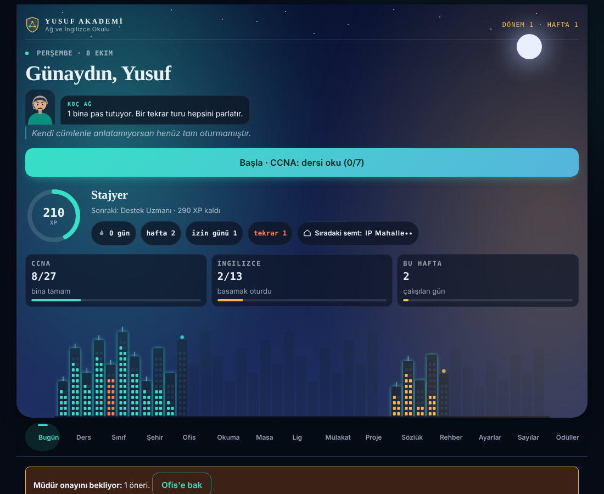
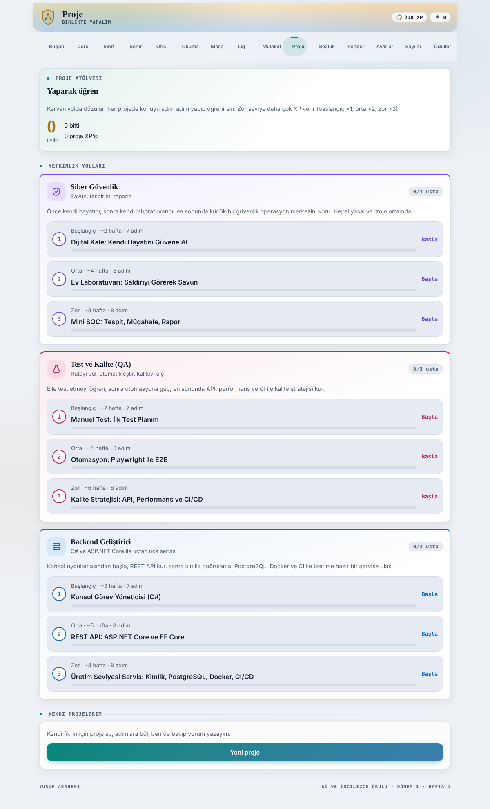
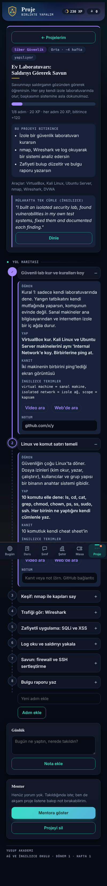

# FORNEX

[](https://yusufydegirmenci.github.io/proofpath/)


**Ücretsiz, oyunlaştırılmış, kanıta dayalı öğrenme platformu.** CCNA, ağ, İngilizce, siber güvenlik, backend, DevOps, test (QA) ve Python derslerini günlük görevler, kısa sınavlar, oyunlar ve proje yol haritalarıyla çalışırsın. Mobil uyumlu bir PWA'dır: derleme adımı ve çalışma zamanı bağımlılığı olmayan `index.html` + `css/` + `js/` yapısı, giriş ve veri katmanı olarak Supabase.

**Canlı sürüm:** <https://yusufydegirmenci.github.io/proofpath/>

*Free gamified learning platform (Turkish): networking/CCNA, English, cybersecurity, backend, DevOps, QA and Python, built as a dependency-free static PWA with a Supabase backend.*



## İçindekiler

[Neler var](#neler-var) · [Hızlı başlangıç](#hızlı-başlangıç) · [Mimari](#mimari) · [Test](#test) · [Bilinen sınırlar](#bilinen-sınırlar) · [Katkı ve çalışma düzeni](#katkı-ve-çalışma-düzeni)

## Neler var

- **Bugün**: günün dersi, kısa kontrol soruları, seri ve XP.
- **Dersler**: her ders için ısınma, anlatım ve dersin kendi içeriğinden kurulan mini sınav.
- **Animasyon Atölyesi**: 70 kurgulu sahneyle ağ, güvenlik, DevOps, test ve backend kavramlarının adım adım hareketli anlatımı.
- **Kavram Atlası, Ders Notları ve Seviye sınavı**: tüm ders hatları için.
- **Oyunlar**: Ağ Koşusu, Fetih ve günlük "Günün meydanı".
- **Lig**: her gün 8 soru (+ yanlış yapılanlardan en fazla 2 tekrar). Yanlışta kartın arkası doğru cevabı ve nedenini gösterir.
- **Proje Atölyesi**: kendi projelerin ve 9 hazır *Yetkinlik Yolu* (siber güvenlik, test/QA, backend; her biri başlangıç, orta, zor). Her adımda Öğren, Yap, Kanıt, İngilizce terimler ve arama sorgusu bulunur.
- **Sınav Haritası** ve **Mülakat Antrenmanı**.
- **Sözlük** ve **Rehber**: ders terimlerinin sade açıklamaları.
- **Rahat okuma ve Sade mod** (Ayarlar): büyük yazı, yüksek kontrast, az sayıda düğme.

| Yetkinlik Yolları | Proje yol haritası |
|---|---|
|  |  |

## Hızlı başlangıç

1. Depoyu indir: `git clone https://github.com/yusufydegirmenci/proofpath.git`
2. `index.html` dosyasını bir tarayıcıda aç, ya da yerelde sunucu başlat: `npx serve .`
3. Veri kaydı ve giriş için `config.js` içindeki Supabase adresi ve **herkese açık (publishable/anon)** anahtar kullanılır. Veriyi koruyan şey `supabase/schema.sql` içindeki satır düzeyi güvenlik (RLS) kurallarıdır. `service_role` anahtarını **asla** bu depoya koyma.
4. Sınav cevap anahtarları bu depoda yoktur; puanı ve geçti kararını sunucu verir.

> `file://` ile açılışta bazı özellikler (SRI'li kod editörü, servis çalışanı) devre dışı kalır; tam deneyim için `http://` ya da canlı sürümü kullan.

## Mimari

- Ön yüz: derleme adımı olmayan, bağımlılıksız HTML/CSS/JS. `index.html` yalnız iskelet ve yükleme sırasıdır; stiller `css/` (7 dosya), uygulama kodu `js/` altında alan klasörlerine bölünmüştür (`cekirdek`, `bugun`, `ders`, `oyun`, `atolye`, `lig`, `proje`, `atlas`, `ag-atolyesi`, `seviye`, `masa`, `mulakat`, `yardim`, `arayuz`, `baslat.js`), büyük veri sabitleri `js/veri/` içindedir. Açık ve koyu tema, telefon genişliği desteklenir.
- Yükleme: betikler `index.html`'de sırayla (`defer`/`async` olmadan) yüklenir ve küresel kapsamda çalışır; yükleme anında çalışan kod yalnız önceki betiklerde bildirilen adlara başvurabilir. Bu kural `node tests/sira.js` ile denetlenir. Yeni kod tek ad alanı `window.PP` altına yazılır.
- Veri: Supabase (e-posta/şifre girişi, `docs` ve `profiles` tabloları, RLS). `supabase-shim.js` uygulamanın `window.claude` arayüzünü Supabase üzerinde sağlar; Claude Artifact içinde çalışırken Artifact'ın kendi `db` katmanı kullanılır. Koleksiyonlar için [docs/VERI_SEMASI.md](docs/VERI_SEMASI.md), kod haritası için [docs/KOD-HARITASI.md](docs/KOD-HARITASI.md), güvenlik başlıkları için [docs/GUVENLIK-CSP.md](docs/GUVENLIK-CSP.md).
- PWA: `manifest.webmanifest` ve `sw.js` (yalnız uygulama kabuğu ve statik içerik önbelleği; kullanıcı verisi önbelleğe alınmaz). Ağ önce, önbellek yedek stratejisi.
- Üretim: derslere göre günlük koç görevleri ve haftalık Müdür görevi dersleri, biletleri ve raporları veritabanına yazar. Koç komutları `content/coach/`, animasyon sahneleri `content/nwscenes/` altında. Öğretim kuralları için [docs/OGRETIM_ILKELERI.md](docs/OGRETIM_ILKELERI.md).
- Tasarım kararları: [docs/UX_ANALIZ.md](docs/UX_ANALIZ.md).

> Testler gerçek Supabase'e bağlanmaz; `tests/stub.js` sahte `window.claude` katmanını sağlar.

## Test

```bash
npm install
npx playwright install chromium
npm run test:smoke   # 15 sekme x 2 tema duman testi
npm test             # tüm testler sırayla (tam koşu uzun sürer)
```

Ayrıntılar, test listesi ve son koşu sonucu: [TESTING.md](TESTING.md). Sürüm notları: [CHANGELOG.md](CHANGELOG.md).

Yükleme sırası denetimi: `npm run test:sira`.

Duman testi 15 sekmeyi 400 px koyu ve 1100 px açık temada açar; sayfa hatası ve yatay taşma arar.

Mobil taraması: `node tests/mobil.js` (3 telefon boyutu × yazı/sade/kontrast ayarları × 15 sekme).

## Bilinen sınırlar

- Soru bankası yapay zekâ destekli incelemelerden geçti ancak bir insan uzman tarafından gözden geçirilmedi; sertifika hazırlığında resmî kaynaklarla (ör. CCNA için Cisco) karşılaştır.
- Testler sahte `window.claude` ve emüle edilmiş telefonla yapıldı, gerçek cihaz testi yok.

## Katkı ve çalışma düzeni

Ana dal `main`. Her özellik ayrı commit olarak gelir.

- Başlamadan önce: `git pull origin main`
- İş bitince: `git add -A && git commit -m "kısa not" && git push origin main`
- Çakışmada önce `git pull --rebase origin main`; `index.html` tek dosya olduğundan çakışmayı satır bazında çöz.
- Hata olunca nereye bakılacağı: [docs/KOD-HARITASI.md](docs/KOD-HARITASI.md).

## Yazar

Yusuf Yahya Değirmenci. [GitHub](https://github.com/yusufydegirmenci) · [LinkedIn](https://www.linkedin.com/in/yusufydegirmenci/)
